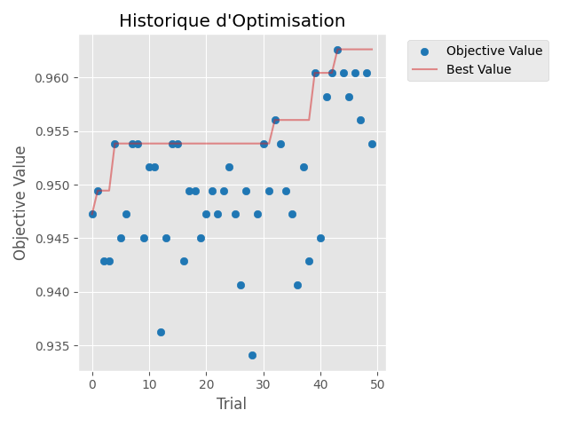
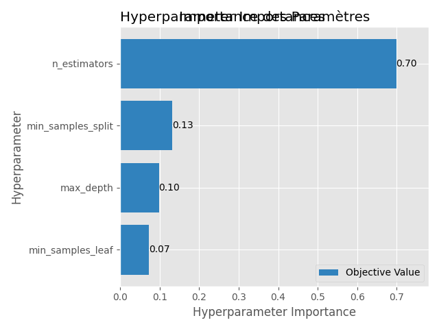
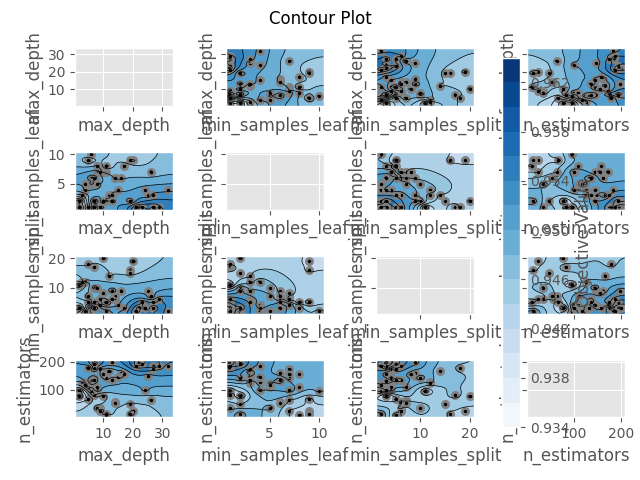

# 🎯 Projet Optuna - Optimisation Random Forest


Projet d'optimisation d'hyperparamètres utilisant **Optuna** pour un classificateur Random Forest sur le dataset de cancer du sein (Breast Cancer Wisconsin). Ce projet démontre comment utiliser Optuna pour trouver automatiquement les meilleurs hyperparamètres et atteindre **96.26% de précision**.

## ✨ Caractéristiques

- 🔍 **Optimisation automatique** avec 50 trials Optuna
- 📊 **Dashboard interactif** pour explorer les résultats
- 📈 **Visualisations détaillées** de l'optimisation
- 🎯 **96.26% de précision** sur la validation croisée
- 📝 **Code documenté** et facile à comprendre
- 🚀 **Prêt à l'emploi** avec vos propres données

## 📊 Résultats

- **Meilleur score de validation croisée :** 96.26%
- **Précision sur l'ensemble de test :** 96%
- **Nombre de trials :** 50

### Meilleurs Hyperparamètres

```python
{
    'n_estimators': 196,
    'max_depth': 22,
    'min_samples_split': 3,
    'min_samples_leaf': 1
}
```

## 📁 Structure du Projet

```
mon_projet_optuna/
├── prepare_data.py           # Chargement des données
├── optimize.py               # Optimisation Optuna
├── visualize.py              # Visualisations
├── train_final.py            # Modèle final
├── requirements.txt          # Dépendances
├── optuna_study.db           # Base de données Optuna
├── optimization_history.png  # Graphique historique
├── param_importances.png     # Importance des paramètres
└── contour_plot.png          # Graphique de contour
```

## 🚀 Installation

```powershell
pip install -r requirements.txt
```

Cela installera tous les packages nécessaires :
- `optuna` : Framework d'optimisation
- `optuna-dashboard` : Dashboard interactif
- `scikit-learn` : Bibliothèque ML
- `pandas` et `numpy` : Manipulation de données
- `matplotlib` : Visualisations

## 📖 Utilisation

### 1. Tester le chargement des données

```powershell
python prepare_data.py
```

### 2. Lancer l'optimisation

```powershell
python optimize.py
```

### 3. Générer les visualisations

```powershell
python visualize.py
```

### 4. Entraîner le modèle final

```powershell
python train_final.py
```

### 5. Lancer le dashboard Optuna

```powershell
optuna-dashboard sqlite:///optuna_study.db
```

Le dashboard sera accessible à : **http://localhost:8080**

Dans le dashboard, vous pouvez :
- 📊 Voir l'historique de tous les trials
- 📈 Analyser l'importance des hyperparamètres
- 🔍 Explorer les graphiques interactifs
- 📉 Comparer les différents trials

Pour arrêter le dashboard, appuyez sur `Ctrl+C` dans le terminal.

## 📈 Performances du Modèle Final

```
              precision    recall  f1-score   support

           0       0.98      0.93      0.95        43
           1       0.96      0.99      0.97        71

    accuracy                           0.96       114
   macro avg       0.97      0.96      0.96       114
weighted avg       0.97      0.96      0.96       114
```

**Matrice de Confusion :**
```
[[40  3]
 [ 1 70]]
```

## 📸 Visualisations

Le projet génère automatiquement plusieurs visualisations :

### Historique d'Optimisation


### Importance des Paramètres


### Graphique de Contour


## 🔍 Fichiers Générés

- `optuna_study.db` : Base de données SQLite contenant tous les trials
- `optimization_history.png` : Évolution du score au fil des trials
- `param_importances.png` : Importance relative de chaque hyperparamètre
- `contour_plot.png` : Relations entre les hyperparamètres

## 🤝 Contribution

Les contributions sont les bienvenues ! N'hésitez pas à :
- 🐛 Signaler des bugs
- 💡 Proposer de nouvelles fonctionnalités
- 📖 Améliorer la documentation
- 🔧 Soumettre des pull requests

## 📝 License

Ce projet est sous licence MIT. Voir le fichier `LICENSE` pour plus de détails.

## 📚 Ressources

- [Documentation Optuna](https://optuna.readthedocs.io)
- [Exemples Optuna](https://github.com/optuna/optuna-examples)
- [Scikit-learn](https://scikit-learn.org)
- [Breast Cancer Dataset](https://scikit-learn.org/stable/datasets/toy_dataset.html#breast-cancer-dataset)

## ⭐ Support

Si ce projet vous a été utile, n'hésitez pas à lui donner une étoile ⭐ !

